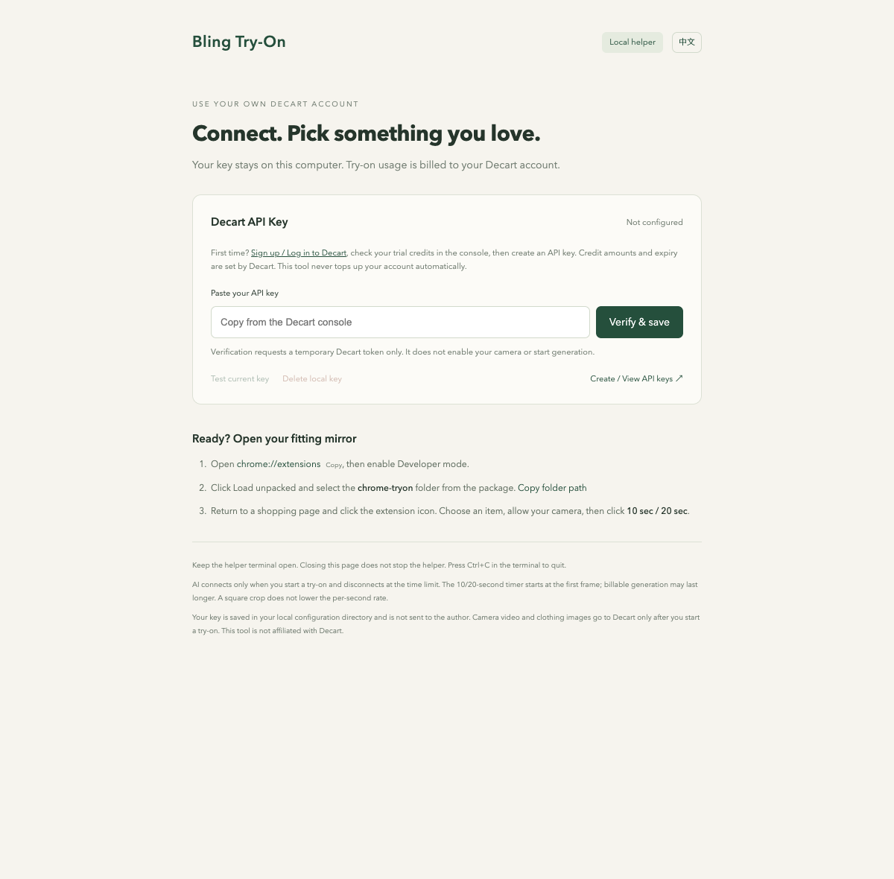

**English** | [简体中文](README.zh-CN.md)

# Bling Try-On · 试衣镜bling

Pick clothing on a shopping website and preview it with live AI. A draggable Chrome fitting mirror and a local helper, using **your own Decart API key (BYOK)**.



Your permanent key stays on your computer. The extension receives short-lived client tokens only. There is no author-hosted key service, extra account or subscription, or other paid AI provider. Decart bills usage to your own account.

> Preview release. Packages are built for macOS/ARM64, Windows/X64 and Linux/X64. Hands-on testing has been on macOS Apple Silicon; real camera and shopping-site compatibility on Windows/Linux still needs device testing. Other architectures require a source build. Signed/notarized installers are not available yet.

## Install

Download the full package matching your OS and architecture from [Releases](https://github.com/sytiris/bling-tryon/releases). Verify it against `SHA256SUMS.txt` and extract the **entire** package to a permanent folder. It includes the local helper, Node runtime and Chrome extension.

1. Run `start-macos.command` (macOS), `start-windows.cmd` (Windows) or `start-linux.sh` (Linux). Keep the helper terminal open. The original Chinese launcher names are also available.
2. The launcher opens `http://127.0.0.1:3000/setup`. If no key is configured, it also opens [Decart API Keys](https://platform.decart.ai/api-keys). Sign up/log in, create your key, and enter it on **your local setup page**. Click **Verify & save**. Verification requests a temporary token; it does not enable your camera or generate video.
3. In Chrome, open `chrome://extensions`, enable **Developer mode**, click **Load unpacked**, and select the package's `chrome-tryon` folder.
4. Open an HTTPS shopping page and click the extension icon. Hover over a clothing image and click **Try this**. Allow the camera, then click **10 sec / 20 sec** to start.

Drag the title bar to move the mirror. **−** minimizes it to a draggable tab; **⚙** opens helper settings. Clicking elsewhere on the shopping page leaves the mirror open.

[Detailed installation, costs and limits](examples/ecommerce/helper/README.md) · [Privacy and data flow](examples/ecommerce/helper/PRIVACY.md)

## Language

The extension and helper follow your browser language: Chinese for Chinese browser locales, English otherwise. Use **EN / 中** in the mirror title bar, or the language button in extension settings and the helper, to switch. Extension and helper preferences are saved separately. Switching text does not restart the camera or a try-on. Chrome's extension-list name follows Chrome's own language: **Bling Try-On** in English and **试衣镜bling** in Chinese.

## Create a Decart account, check credits and set your key

1. Visit the [Decart API console](https://platform.decart.ai/) and complete sign-up/login and any required verification yourself.
2. Check your balance or trial credits in the console. The [official pricing FAQ](https://docs.platform.decart.ai/getting-started/pricing#faq) currently says new accounts receive free credits. Amounts, expiry and eligibility are determined by your console. This project does not issue credits or top up your account. The API is pay-as-you-go and does not require a subscription membership.
3. Create and copy a key on [API Keys](https://platform.decart.ai/api-keys). See the [official authentication guide](https://docs.platform.decart.ai/getting-started/authentication).
4. Paste it into the password field at `http://127.0.0.1:3000/setup` and click **Verify & save**.
5. Return to a shopping page, allow the camera yourself, and click 10 sec or 20 sec. Successful token verification does not guarantee enough balance for generation. If credits are insufficient, check Decart and decide yourself whether to add funds.

Enter keys only on your own local helper page. Do not share them with an agent, in chat, issues or screenshots. You can test, replace or delete the local key in setup. Revoke a leaked key in the Decart console.

## Ask your local agent to install it

Give this instruction to an agent that can operate your computer:

> Download, install and start https://github.com/sytiris/bling-tryon on this computer. Read the repository AGENTS.md first, open the Decart sign-up/API Keys page and local setup page, let me complete registration and enter my key myself, then guide me through loading the Chrome extension.

[AGENTS.md](AGENTS.md) covers selecting the latest matching package, verifying checksums, extracting, starting and locating the extension folder. With no saved key, the launcher opens Decart API Keys, where you can continue to login/sign-up. With a configured key, it opens local setup only. Refreshing setup never opens an external page.

The agent needs local file, terminal and browser capabilities. If it cannot open a desktop browser, it should provide clickable URLs instead. Registration, verification codes, terms, payments, key entry, and extension/camera permission decisions stay with you. Installation does not automatically start a paid try-on.

## Sessions and stopping

- Both durations use `lucy-vton-latest` **standard mode**. The 10/20-second timer starts at the **first decoded frame**. This is not a promise of billable duration; generation before the first frame may also be charged.
- Starting a try-on hides the original camera feed. At the deadline, AI disconnects while the last frame and local camera remain available. Another try-on requires a deliberate click.
- Camera off, minimizing/closing the mirror, hiding/refreshing the shopping page, helper loss and key changes stop generation as soon as possible.
- Errors do not trigger automatic retries. The first-frame timeout is 30 seconds; client and server caps of 45/55 seconds provide a fallback.
- Input is cropped to the center square, then padded to 1280×720. Cropping does **not** lower Decart's per-second rate.


This image comes from a synthetic-camera technical test. It illustrates the interface and video path, not real-person garment fit.

## Limits

Image selection uses image size and page structure; it cannot identify every garment. CSS backgrounds, cross-origin frames, closed components, protected or login-only images may be inaccessible. Some sites block camera use inside embedded windows. Chrome internal pages and the Web Store cannot host the mirror.

The helper listens on 127.0.0.1 only. Keys are saved in the user's local configuration directory and never included in the extension, source, logs or release packages, or routed through the author's servers. This file is not an encrypted vault: local programs with sufficient file permissions can read it. Decart processes the data needed for generation under its own terms, privacy policy and account settings.

## Build from source

Use Node **24.14.1 or a later 24.x version**. Build on the target platform for a matching runtime.

```bash
cd examples/ecommerce
npm ci
npm test
npm run typecheck
npm run build:release
```

The full package is created at repository root `dist/bling-tryon-<platform>-<arch>/`. Run its launcher. Building does not require an API key; do not add your permanent key to CI.

For helper-only debugging: `npm run helper`. `BLING_DATA_DIR` overrides the local configuration directory. A server environment variable `DECART_API_KEY` can supply the initial key; a value saved in setup takes precedence. Deleting it prevents the old environment value from returning at the next start. `BLING_LANGUAGE=en` or `zh` overrides terminal language; web UI language follows the browser.

If you need an HTTP proxy, set your own `TRYON_PROXY_URL`, or inherit `HTTP_PROXY`/`HTTPS_PROXY`. Release launchers enable Node environment-proxy support and bypass local addresses; they do not change system proxy settings.

The original Next.js ecommerce demo is retained at `examples/ecommerce` (`npm run dev`). It shares default port 3000 with the helper, so stop one before running the other. That legacy demo and untouched upstream examples retain their original languages; the distributed Chrome tool and helper are bilingual.

## Source layout and license

- `examples/ecommerce/extension/`: page picker, draggable mirror, camera and WebRTC lifecycle.
- `examples/ecommerce/helper/`: local server, key setup and temporary-token issuing.
- `examples/ecommerce/helper/public/i18n.js`: shared Chinese/English UI phrases.
- `examples/ecommerce/scripts/`: SDK cancellation patch and package builds.
- `examples/ecommerce/tests/`: timer, cancellation, configuration, token and locale checks.
- Other `examples/`: upstream examples kept for reference.

Based on [DecartAI/tryon-examples](https://github.com/DecartAI/tryon-examples) and the Decart JavaScript SDK. The [MIT License](LICENSE) and [third-party notices](THIRD_PARTY_NOTICES.md) are preserved; packages also contain bundled dependency and Node runtime licenses. This tool is not affiliated with Decart.

When reporting issues, provide reproduction steps and redacted errors only. Do not upload keys, tokens, private shopping pages or camera footage.
