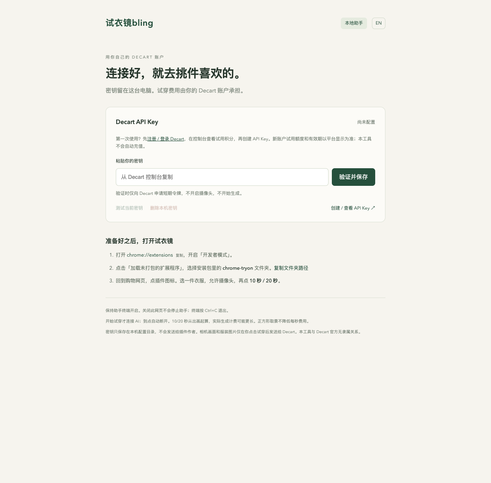
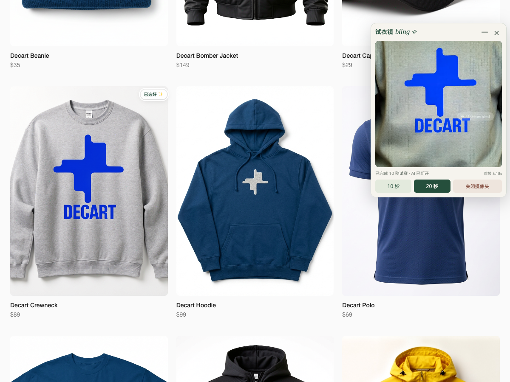

[English](README.md) | **简体中文**

# 试衣镜bling

**bling-tryon**：在购物网页里挑一件衣服，用实时 AI 看看上身效果。Chrome 网页浮窗＋本地助手，每位用户使用自己的 Decart API Key（BYOK）。



永久密钥保存在用户自己电脑的本地助手中；插件只接收短期令牌。没有作者托管的密钥服务，试衣镜不另设账号或订阅，也不接入其他付费AI接口。试穿费用由用户自己的 Decart 账户承担。

> 当前为可试用版本，提供 macOS/ARM64、Windows/X64、Linux/X64 自动构建包；本机实测平台为 macOS Apple Silicon。Windows/Linux 的摄像头与购物网站兼容性仍需对应设备验证，其他架构可从源码构建。系统签名/公证安装器尚未提供。

## 语言

插件和本地助手默认跟随浏览器语言：中文浏览器显示中文，其他语言显示英文。浮窗标题栏的 EN / 中、插件设置页和助手页的语言按钮可随时切换，并各自记住选择。切换只更新文字，不会重开相机或试穿。Chrome 扩展列表名称跟随 Chrome 自身语言：中文为「试衣镜bling」，英文为「Bling Try-On」。

## 安装

优先使用本仓库 **[Releases](https://github.com/sytiris/bling-tryon/releases)** 中与你系统和芯片匹配的完整安装包，内含本地助手、Node运行时及Chrome扩展。

1. 解压整个安装包到固定位置，运行 start-macos.command（macOS）、start-windows.cmd（Windows）或 start-linux.sh（Linux），也可使用保留的中文名称启动器，保持终端开启。
2. 启动器会打开 `http://127.0.0.1:3000/setup`；尚未配置 Key 时，还会自动打开 [Decart API Keys 页面](https://platform.decart.ai/api-keys)。先按下方说明注册/登录、创建 Key，再回到本机页面点击「验证并保存」。验证只申请短期令牌，不启动摄像头或生成视频。
3. Chrome 打开 `chrome://extensions`，开启「开发者模式」，点击「加载未打包的扩展程序」，选择包内 `chrome-tryon` 文件夹。
4. 打开 HTTPS 购物页，点击插件图标。移到衣服图片上点「试试这件」，允许摄像头后主动点 **10 秒 / 20 秒**。

浮窗标题栏可拖动；「−」收起成可拖动小标签；「⚙」打开助手设置。插件不会因网页获得焦点而自动关闭。

详细说明：[安装、费用与已知限制](examples/ecommerce/helper/README.zh-CN.md) · [隐私与数据流](examples/ecommerce/helper/PRIVACY.zh-CN.md)

## 注册 Decart、获取试用积分和设置 API Key

1. 打开 [Decart API 控制台](https://platform.decart.ai/)，自行完成注册/登录和页面要求的验证。
2. 在控制台查看账户余额或试用额度。[官方价格说明](https://docs.platform.decart.ai/getting-started/pricing#faq)目前写明新账户有免费试用额度；具体金额、有效期和使用条件以你的控制台为准。本项目不发放积分，也不会自动充值。Decart API 按使用量计费，无需购买订阅会员。
3. 进入 [API Keys](https://platform.decart.ai/api-keys)，使用页面的创建按钮生成一个 Key，并复制。可参考 [官方 API Key 指南](https://docs.platform.decart.ai/getting-started/authentication)。
4. 回到本机助手 `http://127.0.0.1:3000/setup`，将 Key 粘贴到密码输入框，点击「验证并保存」。看到验证通过后，再加载 Chrome 扩展。
5. 打开购物网页，自己允许摄像头并点击 10 秒或 20 秒开始试穿。Key 验证通过不代表余额一定充足；额度不足时回 Decart 控制台查看或自行决定是否充值。

Key 只填写到你自己电脑的助手页面，不要发给智能体、聊天、Issue 或截图。以后可在助手页测试、更换或删除；撤销已泄露的 Key 需要到 Decart 控制台操作。

## 让你的智能体帮你安装

把这一句话交给能操作你电脑的智能体：

> 请帮我在这台电脑下载安装并启动 https://github.com/sytiris/bling-tryon，先阅读仓库 AGENTS.md，打开 Decart 注册/API Key 页面和本机配置页，让我自己完成注册及密钥填写，再引导我加载 Chrome 扩展。

智能体安装步骤见 [AGENTS.md](AGENTS.md)：选择匹配系统/芯片的最新完整发布包、校验并解压、运行启动器、给出扩展目录。未配置 Key 时，启动器会自动打开 Decart API Keys 页面，用户可从该页面的登录/注册入口继续；已配置时只打开本机设置页，不重复打开 Decart。

自动下载安装和弹出网页需要智能体具备本机文件、终端与浏览器操作能力。无法打开桌面浏览器时，应给出上述两个地址供用户手动打开。用户自行完成注册、验证码、条款确认、密钥粘贴以及扩展/摄像头权限确认；智能体不代替用户充值或自动开始付费试穿。

## 试穿与停止

- 两档均为 `lucy-vton-latest` 标准模式。10/20秒从**第一帧出现**后开始计算，不是账单时长承诺；连接等待期间已开始生成的时间也可能收费。
- 开始试穿后隐藏原摄像头画面。到点断开AI，保留最后一帧和本地相机；下一次必须主动点击。
- 关闭相机、收起/关闭浮窗、网页隐藏或刷新会停止生成；助手退出或密钥变化时也尽快停止。
- 出错或断连不自动重试。首帧等待上限30秒，客户端及服务端总时限45/55秒用于兜底。
- 实际上传前截取中心正方形，再补黑边保持1280×720；裁剪不会降低Decart每秒费用。



上图来自合成摄像头的技术验证，用于展示界面与输出链路，不能代表真人上身贴合效果。

## 适用边界

网页图片使用尺寸和页面结构筛选，不能保证自动识别所有服装。CSS背景图、跨域iframe、封闭组件及防盗链图片可能不可读。部分购物网站禁止嵌入页面使用摄像头，此时插件会明确提示；Chrome内部页面及扩展商店不能注入浮窗。

本地助手只监听127.0.0.1。Key保存在用户配置目录，不写入扩展、源码、日志或发布包，不经由作者的服务器。配置文件不是加密保险库，本机有相应文件权限的程序仍可读取。Decart接收并处理生成所需的数据，其服务条款、隐私政策和账户设置仍然适用。

## 从源码运行

使用Node **24.14.1或更高的24.x版本**。本机发布包携带经过本机验证的运行时；需要别的平台包时在对应平台构建。

```bash
cd examples/ecommerce
npm ci
npm test
npm run typecheck
npm run build:release
```

生成的完整目录位于仓库根 `dist/bling-tryon-<platform>-<arch>/`，运行其中的启动器。构建不需要任何API Key，不要在CI中配置你的永久密钥。

仅调试助手：`npm run helper`。可用 `BLING_DATA_DIR` 指定本机配置目录；也支持从服务端环境变量 `DECART_API_KEY` 初次读取密钥。配置页保存的值优先，删除操作会阻止旧环境值在下次启动时恢复。

需要HTTP代理时，启动前设置自己的 `TRYON_PROXY_URL`，或使用已有 `HTTP_PROXY`/`HTTPS_PROXY`。发布启动器启用Node的环境代理支持，且绕过本机地址，不修改系统代理。

原有Next.js电商示例仍保留在 `examples/ecommerce`，可单独运行 `npm run dev`。它与助手默认共用3000端口，需先关闭其中一个服务。

## 项目结构

- `examples/ecommerce/extension/`：网页选衣、可拖动浮窗、相机与WebRTC生命周期。
- `examples/ecommerce/helper/`：独立本地服务、密钥配置页、短期Token签发。
- `examples/ecommerce/scripts/`：SDK取消补丁、扩展与完整发布包构建。
- `examples/ecommerce/tests/`：计时、取消连接、配置保护和Token约束测试。
- 其余 `examples/`：上游原有示例，保留作参考。

## 来源与许可

基于 [DecartAI/tryon-examples](https://github.com/DecartAI/tryon-examples) 修改，使用Decart JavaScript SDK。保留原项目 [MIT License](LICENSE) 和 [第三方声明](THIRD_PARTY_NOTICES.md)；发布包另含SDK依赖与Node运行时许可。本工具与Decart官方无隶属关系。

反馈问题时请只提供复现步骤和脱敏错误，不要上传API Key、Token、私人购物页面或摄像头画面。
